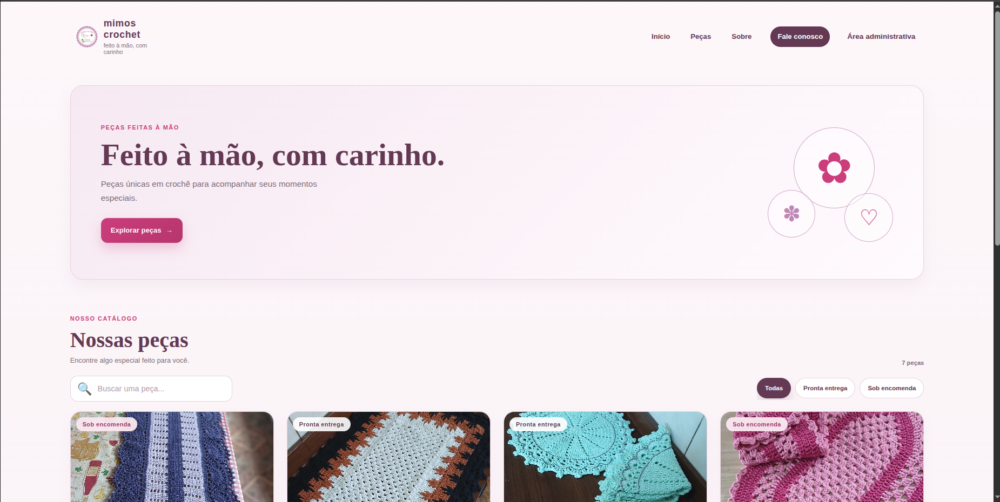
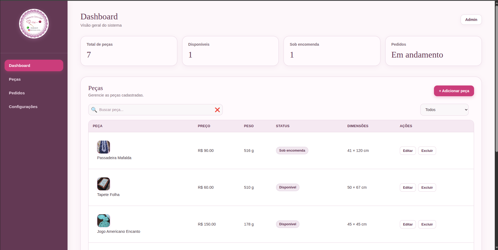

# Mimos Crochê

Sistema de gerenciamento e catálogo digital desenvolvido para uma cliente que trabalha com produtos artesanais de crochê.

A aplicação permite que visitantes explorem os produtos disponíveis no catálogo, enquanto a área administrativa oferece ferramentas para gerenciar os produtos e suas informações.

O projeto foi desenvolvido como uma aplicação Full Stack, com frontend, backend e banco de dados próprios.

## 📸 Screenshots

### Catálogo de produtos

Área pública onde os visitantes podem visualizar os produtos, consultar informações e verificar sua disponibilidade.

### Painel administrativo

Área restrita destinada ao gerenciamento dos produtos cadastrados na plataforma.

## 🚀 Funcionalidades

### Catálogo público

- Listagem de produtos cadastrados.
- Visualização de informações e imagens dos produtos.
- Filtro por disponibilidade.
- Identificação de produtos disponíveis e sob encomenda.

### Painel administrativo

- Autenticação de administradores.
- Cadastro de novos produtos.
- Edição de informações dos produtos.
- Remoção de produtos.
- Upload e gerenciamento de imagens.

## 🛠️ Tecnologias utilizadas

### Frontend

- React
- TypeScript
- Vite
- CSS

### Backend

- Node.js
- Express
- TypeScript
- PostgreSQL

### Serviços e ferramentas

- Cloudinary — armazenamento de imagens.
- Neon — hospedagem do banco de dados PostgreSQL.
- Render — hospedagem do backend.
- Vercel — hospedagem do frontend.
- Git e GitHub — versionamento de código.

## 🏗️ Arquitetura

A aplicação segue uma arquitetura cliente-servidor, na qual o frontend realiza requisições HTTP à API desenvolvida com Node.js e Express.

O backend é responsável pelo processamento das operações, autenticação, regras de negócio e comunicação com o banco de dados PostgreSQL.

O armazenamento das imagens dos produtos é realizado por meio da integração com o Cloudinary.

## 🔐 Autenticação e segurança

- Autenticação baseada em JWT.
- Armazenamento do token em cookie HttpOnly.
- Middleware para autenticação e autorização.
- Controle de acesso às rotas administrativas.

## 🌐 Acesso à aplicação

- **Catálogo:** [Mimos Crochê](https://mimos-crochet.vercel.app/catalog)

## 🧠 Principais desafios e aprendizados

Durante o desenvolvimento do Mimos Crochê, tive a oportunidade de trabalhar com diferentes aspectos do desenvolvimento Full Stack, enfrentando desafios relacionados à integração entre serviços, segurança e gerenciamento de dados.

Entre os principais aprendizados, destaco:

- **Autenticação e autorização:** implementação de autenticação utilizando JWT armazenado em cookies HttpOnly, além de middlewares para proteger rotas e controlar permissões de acesso administrativo.

- **Integração frontend e backend:** desenvolvimento de uma API REST com Node.js e Express, responsável por processar as requisições do frontend e realizar operações no banco de dados.

- **Upload e gerenciamento de imagens:** integração com o Cloudinary para permitir o envio e armazenamento de imagens dos produtos.

- **Banco de dados:** modelagem e implementação de tabelas relacionais utilizando PostgreSQL, trabalhando com operações CRUD e relacionamentos entre dados.

- **Deploy e integração de serviços:** configuração e publicação da aplicação utilizando Vercel, Render e Neon, além da configuração de variáveis de ambiente e comunicação entre serviços hospedados separadamente.

O desenvolvimento desse projeto contribuiu para aprofundar meus conhecimentos em desenvolvimento Full Stack e compreender melhor os desafios envolvidos na construção e manutenção de aplicações utilizadas em cenários reais.

## 👨‍💻 Desenvolvedor

Desenvolvido por **Vinícius Marinho**.

[GitHub](https://github.com/vinivmarinho) · [LinkedIn](https://www.linkedin.com/in/vin%C3%ADcius-marinho-376a8a365/)
